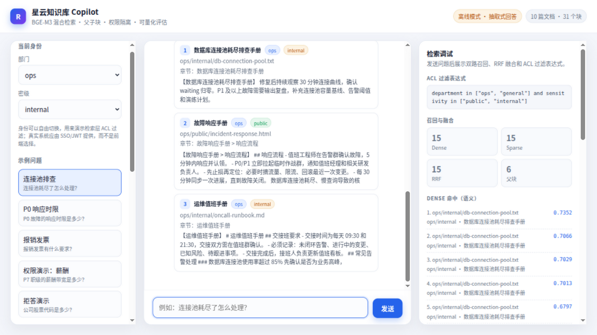

# 企业知识库 RAG（BGE-M3 + Milvus Lite）

一个面向企业内部知识库的 RAG 项目，重点不是「调通一个大模型」，而是把检索质量、权限隔离和效果评估做成可解释、可验证的工程。

> **这是一个学习项目，不是生产可用的知识库系统。** 语料是 69 篇中文文档、602 个检索块、50 条评估用例，指标用于验证工程实现的正确性，不代表真实规模下的检索效果。身份由前端下拉框选择，真实系统应来自 SSO/JWT 并在服务端强制校验。



## 效果速览

- **69 篇中文文档**，覆盖 `.pdf` / `.md` / `.html` / `.docx` / `.pptx` 五种格式（解析层共支持 8 种，含 `.csv` / `.xlsx` / `.txt`）。
- **602 个检索块**，BGE-M3 稠密向量（1024 维）+ 稀疏词权重双路召回，加权 RRF 融合，bge-reranker-v2-m3 二阶段精排。
- **黄金测试集 64 条**：53 条检索（含 12 条镜像/近似文档难例）、8 条权限、3 条拒答。
- 离线评估消融（2026-10-26，64 条用例，ACL 违规全部为 0）：等权 RRF 基线 MRR@6 = 0.972；开精排 0.975；sparse 1.3× 加权 0.981。默认配置取等权 + 精排——64 条样本上 0.006 的差距只有一次排名翻转，不足以支撑为小集合调参，详见[评估](#评估)。
- 检索结果 LRU 缓存（key 含索引行数，入库自动失效）；`/chat` 全链路异步 + SSE 流式输出；每 IP 限流；请求 ID 透传。
- 提供 CLI、FastAPI、单页 Web UI；UI 可切换部门/密级，实时展示两路召回、RRF 融合和精排得分。
- **58 个 pytest 用例**，不加载 BGE-M3、不调用 LLM，全部离线可跑。

语料分布：

| 部门 | 文档数 | 块数 | | 密级 | 文档数 | 块数 |
| --- | ---: | ---: | --- | --- | ---: | ---: |
| ops | 48 | 509 | | public | 48 | 506 |
| finance | 9 | 42 | | internal | 18 | 86 |
| general | 8 | 36 | | confidential | 3 | 10 |
| rd | 3 | 10 | | | | |
| hr | 1 | 5 | | | | |

## 这个项目解决了什么

| 问题 | 做法 |
| --- | --- |
| 语义检索找不到关键词精确匹配 | BGE-M3 dense + sparse 双路召回，RRF 融合 |
| 长文档切碎后上下文丢失 | 父块（约 1200 字）保存上下文，子块（约 350 字）进索引 |
| 表格被按字符切断 | 切分前先按行识别表格，表格作为原子单元，保留最近标题 |
| 更新文档时索引残留或重复 | 确定性主键 + `upsert` + 文档变短时先删尾巴 |
| 无权内容被模型看到 | 在 Milvus 检索参数里做部门 + 密级 filter，而不是取回后再过滤 |
| 效果无法量化 | Recall@K、MRR@K、Faithfulness、ACL 违规数，ACL 违规退出码 2 |
| 没有 Key 就无法演示 | 离线抽取式降级；检索、UI、评估的检索指标都能跑 |
| 多格式语料难维护 | 一份中文 Markdown 母版生成 5 种格式，回读校验排版一致性 |

## 架构

### 离线入库

```text
docs/<部门>/<密级>/*.{pdf,md,html,docx,pptx,...}
  → 按扩展名解析（表格统一转 Markdown 表格）
  → 清洗（统一换行、去零宽字符、压缩空白；查询端同一套规则）
  → 权限推断（CLI 覆盖 > frontmatter > 目录 > 默认 general/public）
  → 表格原子单元保护
  → 父块 ~1200 字 / 子块 ~350 字（子块带标题前缀）
  → BGE-M3：CLS 稠密向量 + sparse_linear 稀疏权重
  → Milvus upsert（主键 sha1(doc_id#chunk_index)，幂等）
  → SQLite registry 记录 content_hash、chunk 数、权限
```

### 在线问答

```text
query
  → 多轮时用轻量模型改写为独立问题（单轮不改写）
  → dense top30 + sparse top30（两路都带 ACL filter）
  → RRF(k=60) 融合
  → 按 parent_id 去重，取 top6 父块
  → Prompt：只依据资料、[n] 引用、资料不足拒答、忽略文档内指令
  → 主 LLM 生成 → 答案 + 引用 + 检索调试信息
```

### 目录结构

```text
rag-learning/
├── docs/                        # 中文语料，按 <部门>/<密级>/ 组织（69 篇）
├── zh_src/                      # 中文 Markdown 母版，<部门>__<密级>__<slug>.md
├── data/                        # milvus.db、registry.sqlite（gitignore）
├── eval/
│   ├── golden_set.jsonl         # 50 条黄金测试集
│   └── reports/                 # 每次评估的 JSON 报告（gitignore）
├── src/rag_learning/
│   ├── config.py                # RAG_ 前缀配置，路径相对项目根
│   ├── cleaner.py               # 文档端/查询端共用清洗
│   ├── chunker.py               # 表格原子单元 + 父子块
│   ├── embedder.py              # BGE-M3 dense + sparse
│   ├── vector_store.py          # Milvus schema / upsert / 检索 / 尾巴删除
│   ├── registry.py              # SQLite 文档注册表
│   ├── ingest.py                # 增量入库
│   ├── llm.py                   # 智谱 / DeepSeek / 离线
│   ├── loaders/                 # 8 种格式解析 + ACL 推断
│   ├── retrieval/               # 查询改写 / 混合检索 / RRF / filter
│   ├── generation/              # Prompt / 引用 / 拒答
│   ├── evaluation/              # 指标 / 裁判 / 评估入口
│   ├── pipeline.py              # 端到端组装
│   ├── api.py                   # FastAPI
│   ├── cli.py                   # ingest / ask / eval / probe / serve / stats
│   ├── probe.py                 # 模型、向量库、LLM 自检
│   └── web/index.html           # 单页 Web UI
├── scripts/
│   ├── build_zh_corpus.py       # 母版 -> 5 种格式 + 回读校验（当前语料由它生成）
│   ├── build_demo_docs.py       # 最早的演示文档脚本（已废弃，输出到 docs_legacy_demo/）
│   └── probe_m0.py              # 最初的 M0 技术验证脚本
└── tests/                       # 49 个离线测试
```

## 快速开始

前置条件：

- Python 3.12（仓库带 `.python-version`，用 [uv](https://docs.astral.sh/uv/) 或 pyenv 都可以）
- 本地 BGE-M3 模型（约 2.2GB）。放到项目根下的 `BGE-M3/`，或用环境变量 `RAG_BGE_M3_PATH` 指定绝对路径。
- bge-reranker-v2-m3（约 2.3GB，可选）：放到项目根同名目录即自动启用精排；缺失时检索退回纯 RRF，不影响运行。
- API Key 可选：不填则自动进入离线抽取式模式，检索、UI、检索类评估仍可运行。

两个模型都可以从 HuggingFace 镜像下载（国内推荐 `HF_ENDPOINT=https://hf-mirror.com`，并设 `HF_HUB_DISABLE_XET=1` 绕开 xet 协议 401）：

```bash
HF_ENDPOINT=https://hf-mirror.com HF_HUB_DISABLE_XET=1 .venv/bin/python -c \
  "from huggingface_hub import snapshot_download as d; d('BAAI/bge-m3', local_dir='BGE-M3'); d('BAAI/bge-reranker-v2-m3', local_dir='bge-reranker-v2-m3')"
```

```bash
# 0. 装依赖（uv 或 pip 二选一）
uv sync
# 或：python -m venv .venv && .venv/bin/pip install -e .

# 1. 配置
cp .env.example .env
# 编辑 .env：按需填 ZHIPUAI_API_KEY；确认真实模型路径 RAG_BGE_M3_PATH

# 2. 自检：模型加载、dense/sparse、milvus-lite 双路检索
.venv/bin/python -m rag_learning probe

# 3. 入库（第二次运行应全部 unchanged）
.venv/bin/python -m rag_learning ingest

# 4. 问答
.venv/bin/python -m rag_learning ask \
  -q "UPI 的单笔和每日交易限额是多少" \
  --dept ops --clearance internal --debug

# 5. 交互式多轮
.venv/bin/python -m rag_learning ask --dept ops --clearance internal

# 6. 评估（不花钱，只跑检索指标和 ACL）
.venv/bin/python -m rag_learning eval --no-faithfulness

# 7. 启动 API + Web UI
.venv/bin/uvicorn rag_learning.api:app --host 127.0.0.1 --port 8000
# 浏览器打开 http://127.0.0.1:8000/ ，Swagger 在 /docs
```

### 常用命令

| 命令 | 作用 |
| --- | --- |
| `python -m rag_learning ingest` | 全量扫描 `docs/`，未变化文档跳过 |
| `python -m rag_learning ingest <文件>` | 只入库一个文件（不能与 `--force` 同用） |
| `python -m rag_learning ingest --force` | 清空后全量重建集合和索引，验证无残留 |
| `python -m rag_learning ingest --department ops --sensitivity internal` | 单文件入库时覆盖权限 |
| `python -m rag_learning ask -q "..." --dept ops --clearance internal` | 单次问答 |
| `python -m rag_learning ask --dept hr --clearance internal` | 交互式多轮 |
| `python -m rag_learning eval` | 跑黄金集（有 Key 时包含 Faithfulness） |
| `python -m rag_learning probe --live` | 额外真实调用一次 LLM（会产生费用） |
| `python -m rag_learning serve` | 启动 API + UI |
| `python -m rag_learning stats` | 查看模型、向量库、文档状态 |

### 语料是怎么来的

`docs/` 里的 69 篇文档由 `zh_src/` 的中文母版生成，每篇**只部署一种格式**到 `docs/`（按 pdf / md / docx / html / pptx 轮换）。原因：同一内容部署多份格式副本会被索引多次，导致检索结果重复、评估匹配到错误文档。

```bash
.venv/bin/python scripts/build_zh_corpus.py            # 从 zh_src 生成全部格式
.venv/bin/python scripts/build_zh_corpus.py --verify   # 只回读校验，不重新生成
```

脚本会用项目自己的 `load_document` 回读每种格式，按「实质字符片段覆盖率」校验排版一致性（阈值 95%），而不是简单比字符数——否则 PDF/PPTX 丢失 `| - : * #` 等 Markdown 标记会被误判成内容丢失。

> **`--verify` 的已知局限**：它假设每篇的 5 种格式都存在，因此对「每篇只部署一种格式」的 `docs/` 会报大量 `文件未生成`。这是校验模式与部署策略的不一致，不影响生成流程；如需校验，请先对同一目录完整生成 5 种格式再跑。

> **注意**：格式轮换后，`eval/golden_set.jsonl` 里的扩展名会失效。重新部署语料后必须按 stem 重新解析实际扩展名，否则评估会因路径对不上而误报。

## BGE-M3 是怎么用的

BGE-M3 一次前向可以同时产出两种表示：

1. **稠密向量（dense）**：取最后一层第 0 个 token（CLS）的 1024 维隐状态，做 L2 归一化。它表示整段文本的语义，用于语义相似检索。
2. **稀疏向量（sparse）**：把每个 token 的隐状态送进 `sparse_linear.pt`（1024→1 的线性层），ReLU 后得到该 token 的重要性权重；同一 token 多次出现取最大权重。结果形如 `{token_id: 权重}`，用于关键词检索。

本项目没有安装 `sentence-transformers` 或 `FlagEmbedding`，而是用裸 `transformers` + `torch` 实现：

```python
model = AutoModel.from_pretrained(
    "<BGE-M3 模型目录>",
    dtype=torch.float16,
    use_safetensors=False,   # 模型目录只有 pytorch_model.bin
)
hidden = model(**inputs).last_hidden_state
dense = F.normalize(hidden[:, 0].float(), p=2, dim=-1)
sparse = torch.relu(hidden.float() @ sparse_weight.T + sparse_bias)
```

在 RTX 3050 Laptop（4GB 显存）上的实测：

- fp16 加载后显存约 **1083 MiB**；
- batch=8、最大长度 1024，编码 3 条短文本约 0.4 秒（模型加载后）；
- 查询端最大长度 256，进一步降低显存和延迟；
- 显存不足时会自动拆小 batch，仍不足则切 CPU 并打 WARNING。

## 权限模型

每个 chunk 带两个字段：

- `department`：`general` / `hr` / `finance` / `ops` / `rd`
- `sensitivity`：`public` < `internal` < `confidential`

用户身份 `UserContext(department, clearance)` 的可见规则：

```text
(department == 用户部门 or department == "general")
and sensitivity in [所有 <= 用户密级的级别]
```

例如 `ops/internal` 能看到 `ops` 和 `general` 部门的 `public` + `internal`，但看不到任何 `confidential`，也看不到 `hr` 的文档。

权限声明优先级：

1. **CLI 覆盖**：`--department hr --sensitivity confidential`
2. **frontmatter**：Markdown/TXT 文件头的 `department` / `sensitivity`
3. **目录结构**：`docs/<部门>/<密级>/...`
4. **默认值**：`general/public`

过滤表达式在 Milvus 的 `search(filter=...)` 里执行，无权内容不会进入候选集；生成前还有一次 Python 侧防御性校验，双保险。

## 数据模型

Milvus 集合 `rag_chunks`：

| 字段 | 类型 | 说明 |
| --- | --- | --- |
| `pk` | VARCHAR(64) | `sha1(doc_id#chunk_index)`，确定性主键 |
| `doc_id` | VARCHAR(64) | `sha1(相对路径)[:16]` |
| `chunk_index` | INT64 | 文档内连续编号 |
| `parent_id` | VARCHAR(64) | 父块 ID，用于检索后去重 |
| `child_text` | VARCHAR(8192) | 进索引的子块（带标题前缀） |
| `parent_text` | VARCHAR(65535) | 生成时使用的父块上下文 |
| `heading` | VARCHAR(2048) | 标题路径 |
| `title` / `source_path` | VARCHAR | 文档标题与相对路径 |
| `department` / `sensitivity` | VARCHAR | 权限字段 |
| `content_hash` | VARCHAR(64) | 文件 sha256，用于增量判断 |
| `dense` | FLOAT_VECTOR(1024) | BGE-M3 稠密向量，IP 度量 |
| `sparse` | SPARSE_FLOAT_VECTOR | BGE-M3 稀疏权重，`SPARSE_INVERTED_INDEX` + IP |

SQLite `documents` 表记录 `doc_id / rel_path / content_hash / department / sensitivity / doc_format / chunk_count / indexed_at / status`，用于增量入库和文档列表。

## 评估

黄金集在 `eval/golden_set.jsonl`，三种类型：

- `retrieval`：有 `expected_paths`，计算 Recall@K 和 MRR@K（K 跟随检索配置 `top_k_final`，当前为 6）。
- `acl`：有 `forbidden_paths`，检查是否出现用户无权访问的部门/密级。
- `refusal`：语料外问题，检查有 Key 时是否明确拒答。

指标定义：

- **Recall@K**：前 K 个父块覆盖了多少预期文档（K = `top_k_final`）。
- **MRR@K**：第一个相关文档排名的倒数。
- **Faithfulness**：LLM 裁判逐条判断答案是否有资料支持；系统正确拒答时直接记 1.0，避免指标假低。
- **ACL 违规数**：最终上下文和两路召回里，任何超出用户可见范围的 chunk 都计数。

消融结果（69 篇 / 602 块 / 64 条用例，2026-10-26 真实输出）：

| 检索配置 | Recall@6 | MRR@6 |
| --- | --- | --- |
| 等权 RRF（基线） | 1.000 | 0.972 |
| 等权 RRF + 精排（默认） | 1.000 | **0.975** |
| sparse 1.3× 加权 RRF | 1.000 | 0.981 |
| sparse 1.3× 加权 + 精排 | 0.981 | 0.969 |

四组配置的 ACL 违规都是 0（审计覆盖全部 30 条原始召回）。Faithfulness / 拒答需要有效 API Key，最后一次 Key 有效时为 3/3。

两组数字值得单独说：

- **精排不是纯赚**：cross-encoder 修好了 3 个语义镜像用例（q14/q16/h12 的 MRR 0.5 → 1.0），却把 2 个关键词精确匹配用例（q28 IFSC 代码、h04 ATM 取款点）的第一名排错了。语义理解和精确匹配的偏好不同，精排偏向前者。
- **加权不是越大越好**：sparse 1.3× 单用时 MRR 最高（0.981），叠加精排后反而 Recall 掉到 0.981——精排把融合阶段已经排对的顺序又洗了一遍。64 条样本上这些差距都在一次排名翻转的噪声范围内，所以默认配置保持等权 + 精排，把权重留成 `RAG_RRF_DENSE_WEIGHT` / `RAG_RRF_SPARSE_WEIGHT` 两个可调参数。

难例集（h01-h12）专门瞄准双塔检索的能力边界：镜像文档对（斯里兰卡/孟加拉/尼泊尔/不丹各有「分行网络」和「ATM 分布」一对）、近似贷款产品（两轮车 vs 汽车 vs 经营贷）、同构城市名录（浦那/金奈/孟买）。等权基线上 q14/q16/h12 的第一名确实被镜像文档抢走，精排后三者全部修正——难例的价值就是把这类差距从「不知道」变成「可测量」。

退出码：

- `0`：全部达标；
- `1`：Recall < 0.85、Faithfulness < 0.9、拒答失败或用例执行失败；
- `2`：存在 ACL 违规（可直接做 CI 卡点）。

真实 LLM 评估（会产生少量费用）：

```bash
.venv/bin/python -m rag_learning eval
```

## API

| 方法 | 路径 | 说明 |
| --- | --- | --- |
| GET | `/api/v1/health` | 模型、Milvus、文档数量状态 |
| GET | `/api/v1/meta?department=ops&clearance=internal` | 部门、密级、LLM 信息，计数按身份过滤 |
| GET | `/api/v1/documents?department=ops&clearance=internal` | 按身份过滤后的文档列表 |
| POST | `/api/v1/search` | 只检索；`debug=true` 时返回双路召回和 RRF 调试信息 |
| POST | `/api/v1/chat` | 检索 + 生成，返回答案、引用、会话历史 |
| POST | `/api/v1/chat/stream` | 同 `/chat`，SSE 流式输出（delta + done 事件） |
| GET | `/` | 单页 Web UI |
| GET | `/docs` | Swagger |

请求示例：

```bash
curl -s http://127.0.0.1:8000/api/v1/chat \
  -H 'Content-Type: application/json' \
  -d '{
    "query": "UPI 的单笔和每日交易限额是多少？",
    "department": "ops",
    "clearance": "internal",
    "session_id": "demo",
    "debug": true
  }'
```

## 测试

```bash
.venv/bin/python -m pytest -q
```

覆盖内容：

- 清洗顺序与幂等、零宽字符；
- 1500+ 字符表格保持原子、超 60KB 表格降级切分；
- 确定性主键、父子块映射、chunk_index 连续；
- 多格式解析（含 PDF 中文提取、DOCX 标题转 Markdown）、表格转 Markdown、ACL 优先级；
- milvus-lite 建库、dense/sparse 检索、filter、尾巴删除、force 重建；
- 增量入库：重复 ingest unchanged、文档变短无残留、删除文档清理索引；
- RRF 融合、父块去重、ACL 泄漏拦截；
- 生成降级、引用编号过滤、拒答；
- 评估指标解析（含智谱 XML 风格输出）；
- FastAPI 端点与 OpenAPI。

测试使用 `FakeEmbedder`（8 维）和不调用 LLM 的桩，不会加载 BGE-M3、不产生费用。语料相关断言采用动态下限（`>= 41`），避免扩充语料时测试失效。

## 部署

默认用 milvus-lite（`data/milvus.db`），零依赖适合开发。要扛并发或多进程访问时切独立 Milvus，代码零改动，只换环境变量：

```bash
# 1. 起一个独立 Milvus（etcd + minio + milvus 三件套）
docker compose -f docker-compose.milvus.yml up -d

# 2. 指向它并重建索引（schema 与 milvus-lite 完全一致）
export RAG_MILVUS_URI=http://127.0.0.1:19530
.venv/bin/python -m rag_learning ingest --force
```

模型权重不入库：BGE-M3 和 bge-reranker-v2-m3 都从 HuggingFace 下载，放到项目根目录（或用 `RAG_BGE_M3_PATH` / `RAG_RERANKER_PATH` 指定）。reranker 目录不存在时检索自动退回纯 RRF，不报错。

指标回归自动化：`.github/workflows/eval.yml` 每天北京时间 04:00 跑全量黄金集（CI 里自动下载模型、入库、评估，报告存 artifact）。需要在仓库 Settings → Secrets → Actions 配置 `ZHIPUAI_API_KEY` 才会跑 Faithfulness 和拒答，没配 Key 也照常出检索指标。

## 已知限制

- **身份是演示用的**：部门/密级由前端下拉框选择，真实系统应来自 SSO/JWT，并在服务端强制校验。README 和 UI 都明确写了这一点。
- **milvus-lite 是单机嵌入式**：同一时间不要一边 `serve` 一边跑 `ingest`；推荐入库完成后再启动 API。需要并发写入或多进程时切独立 Milvus（见 [部署](#部署)）。
- **4GB 显存**：BGE-M3 和 reranker 都是 fp16、batch 8，最大长度 1024；推理全程持锁串行执行，显存峰值约 2.4GB。没有做 ColBERT 多向量，显存和复杂度会失控。
- **离线模式是抽取式**：没有 LLM 时只返回检索片段，不会判断相关性，也不会拒答语料外问题；拒答能力需要真实 LLM。
- **PDF 只支持数字版**：可提取文本过少的 PDF 会明确报错，不做 OCR。
- **黄金集仍是小规模**：50 条用例用于验证工程正确性，不是统计意义上的评测集；且部分用例的候选池不足 K 篇，Recall@K 会偏乐观。
- **会话在内存里**：API 的 session history 存在进程内，重启即丢失；生产应放 Redis/DB。
- **没有流式输出**：当前是一次性返回；可以在此基础上加 SSE。

## 踩坑记录

1. **transformers 5.3 加载 `pytorch_model.bin`**：需要显式 `use_safetensors=False`。BGE-M3 目录没有 safetensors，直接加载会走旧版 PyTorch 权重分支。
2. **`sparse_linear.pt` 是 OrderedDict**：包含 fp16 的 `weight [1,1024]` 和 `bias [1]`，不是裸 tensor。稀疏权重要在 fp32 下算，避免 fp16 下溢。
3. **milvus-lite 跨进程会 released**：入库进程关闭后，API 进程第一次查询前必须 `load_collection()`，否则报 `Collection 'rag_chunks' is in state 'released'`。
4. **稀疏向量不能是空 dict**：Milvus 要求至少一个非零权重，空的时候用 `{0: 1e-7}` 占位。
5. **VARCHAR 的 `max_length` 是字节数**：中文一个字符 3 字节，父块字段直接给到 65535，子块给 8192，并在写库前按 UTF-8 截断。
6. **RRF 会打平**：两路都是第 1/第 2 的文档分数完全相等，评估时不能假设严格大于，只能比大小和集合。
7. **主键字段不叫 `id` 时**：pymilvus 的 hit 需要按自定义主键名（这里是 `pk`）取值，不能直接 `hit["id"]`。
8. **`MILVUS_URI` 不能作为配置键**：pymilvus 导入时会自己 `load_dotenv()`，本地路径会被判为非法 URI。本项目所有配置统一 `RAG_` 前缀。
9. **本机 LibreOffice 在沙箱里无法加载文件**：PDF 演示文档改用 reportlab + `STSong-Light` CID 字体生成，pypdfium2 能正常提取中文。
10. **中文字体缺字形**：`STSong-Light` 没有 `·`，列表圆点必须用 `bulletText="•"`，否则显示成方框。
11. **同一内容别部署多种格式**：会让同一文本被索引多次，检索结果重复、评估匹配错文档。本项目每篇只部署一种格式。
12. **格式轮换会让黄金集路径失效**：重新部署语料后必须按 stem 重解析扩展名（本次有 4 条从 `.docx/.html/.md/.pptx` 变成 `.pdf`）。

## 成本说明

- `probe`、`pytest`、`ingest`、`eval --no-faithfulness` **不调用 LLM，零费用**。
- `ask` / `chat` 有 Key 时会调用一次主 LLM（多轮再加一次轻量改写）。
- `eval` 有 Key 时每条用例 1 次生成 + 1 次裁判，50 条约 100 次调用；使用 `glm-4-flash` 成本很低。
- `probe --live` 会额外调用一次 LLM。

## 语料来源

`docs/` 下的中文语料翻译自 [udayallu/RAG-Multi-Corpus](https://github.com/udayallu/RAG-Multi-Corpus)（MIT License, Copyright (c) 2025 UDAY ALLU）中的 ZX Bank 部分。

- 原始数据为英文，本项目的译文由会话中的语言模型逐篇产出，**不调用项目配置的 LLM、不消耗用户 API 额度**。
- 翻译仅用于学习与演示，原始版权归原作者所有；MIT 许可要求保留的版权声明见 [NOTICE](NOTICE)。
- 中文母版存放在 `zh_src/`，命名格式 `<部门>__<密级>__<slug>.md`，由 `scripts/build_zh_corpus.py` 生成多格式副本。
- 原始 71 篇中有 2 组内容重复（`Personal Loan.md` 与 `Personal Loan Information.md`、`ZX Bank Agriculture Loan.md` 与 `Agriculture Loan.md`），已跳过，最终 69 篇。

## 简历表述参考

> 基于 BGE-M3 实现企业知识库 RAG：手写 dense（CLS 池化）+ sparse（sparse_linear 词权重）双路编码，结合 RRF 融合与父块上下文扩展；在 69 篇多格式中文文档、602 个检索块上达到 Recall@6=1.000、MRR@6=0.976。

> 设计部门 + 密级双维度 ACL，在 Milvus 检索层执行 filter，并以「生成前二次校验」兜底；6 条越权用例 ACL 违规为 0，评估脚本在违规时以退出码 2 阻断 CI。

> 实现表格原子单元与父子块切分，1500+ 字符表格不被长度切分破坏；使用确定性主键 + content_hash 增量入库，重复 ingest 全量跳过，文档变短时先删尾巴再 upsert，避免索引残留。

> 搭建多格式语料生产链路：一份中文 Markdown 母版生成 PDF/DOCX/PPTX/HTML，并用项目自身 loader 回读校验片段覆盖率（阈值 95%），避免「标记消失被误判为内容丢失」。

> 搭建 FastAPI + 单页 Web UI 的检索演示台，可视化 dense/sparse 两路命中、RRF 融合和 ACL 表达式；配套 49 个离线 pytest 用例，测试不依赖 GPU 和外部 API。

## License

代码以 MIT License 发布，见 [LICENSE](LICENSE)。`docs/` 语料为第三方数据的翻译衍生作品，其版权与许可声明见 [NOTICE](NOTICE)。
